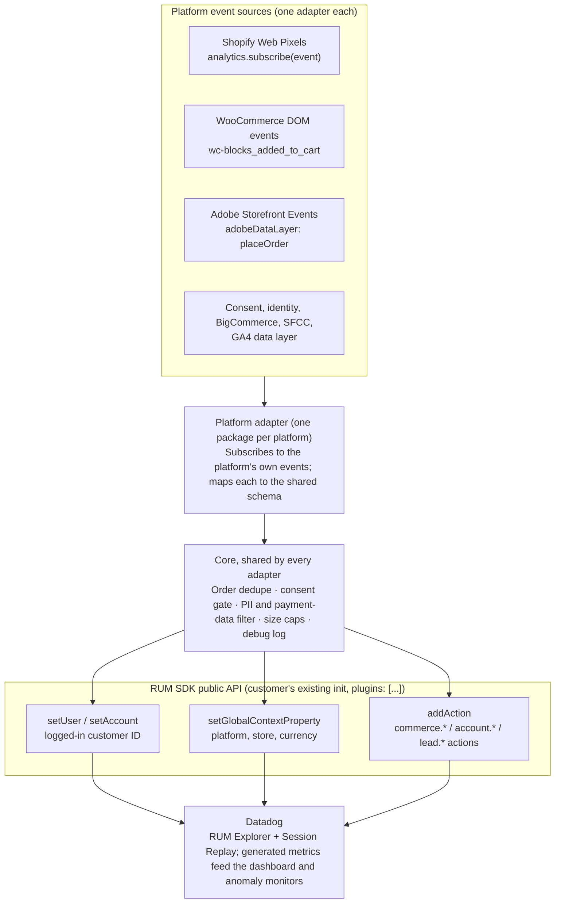
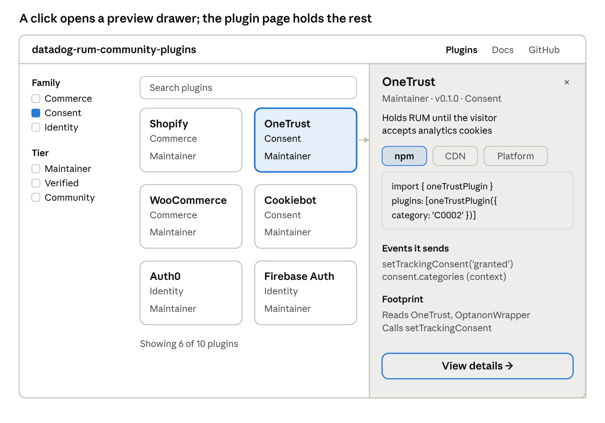

# PRD: Datadog RUM Integration Plugins

Oct 23, 2026 · Kyle Taylor

> Exported from the Claude Doc on 2026-10-23. From here on, this file is the source of truth; the doc is a shareable snapshot.

A community-maintained library of Datadog Browser RUM plugins for popular commerce platforms, consent managers and login providers. Each plugin sets the user, account and session context and emits standard commerce custom actions with no custom code, so cart and checkout data become Datadog custom metrics on day one. The MVP lives under a personal GitHub and npm account (@kyletaylored, like the existing datadog-rum-interceptor package) and is not an official Datadog product. Contributors own the long tail, the way the GTM Community Template Gallery works.

## Problem

The Browser RUM SDK collects sessions, views, actions, resources, errors and long tasks automatically. Business context does not come for free. Who the user is, which account they belong to, and what was in the cart all need hand-written calls to `setUser`, `setAccount`, `setGlobalContextProperty` and `addAction`.

That creates three problems:

- **Slow time to value in evaluations.** A prospect who wants to see order volume and revenue anomalies has to ship custom code to their storefront first. Most evaluations end before that happens.
- **No standard.** Every team picks its own action names and attribute shapes (`checkout`, `purchase`, `order_complete`; `total`, `cart.value`, `amount`). Dashboards, monitors and custom metrics can't be reused across customers.
- **Platform lock-out.** On managed platforms (Shopify, Square Online, BigCommerce) the merchant often can't write app code at all. The data exists in the platform's own event APIs, but nothing bridges it to RUM.

The official [`@datadog/browser-rum-shopify`](https://github.com/DataDog/browser-sdk/tree/main/packages/browser-rum-shopify) package proves the plugin pattern but stops short of business data. `shopifyPlugin` is a `RumPlugin` whose `onInit` makes the SDK work inside the Customer Events pixel sandbox: it patches `cookieStore`, `navigator.locks` and `document.hasFocus`, and turns off replay, resources and auto-tracked interactions. It then binds three Web Pixel events: `page_viewed` to `startView`, `clicked` to a click action, and `ui_extension_errored` to `addError`. It never subscribes to `checkout_completed`, cart events or customer data, so order count, revenue and `setUser` remain copy-paste examples in the docs.

Datadog can't officially support six or more platforms with this depth, so the library starts as a personal, community-scoped project with no Datadog support commitment.

## Goals and non-goals

The MVP succeeds if a merchant installs one package, adds no custom code, and sees order count and revenue as Datadog metrics within a day.

**Goals**

1. One install per platform (CDN snippet, npm package, or the platform's app/plugin mechanism) that hooks into an existing RUM init.
2. A single versioned **commerce event model**: the same action names and attribute paths on every platform.
3. Automatic `setUser` / `setAccount` for logged-in shoppers and session context such as store, currency and locale.
4. A ready-made Datadog pack: generated metrics, a dashboard and anomaly monitors that work on any plugin's data.
5. Safe by default: no PII beyond what the merchant opts into, and consent respected.
6. A contribution kit good enough that a partner or agency can ship a new adapter in a week without help from the maintainer.

**Non-goals for the MVP**

- A GTM-style visual tag builder. Adapters are code at first; a declarative mapping format is Phase 3.
- Server-side or webhook order capture. The plugin measures what the browser sees.
- Replacing analytics tools. Events exist to correlate business outcomes with performance, errors and replays.
- Mobile SDKs (iOS, Android, React Native, Flutter).
- Headless storefronts with no platform-provided event source (they use the generic adapter in Phase 2).

## Users

Three people install, read or sell this. Each needs a different thing from it.

| User | Job to be done | What they need from the plugin |
| --- | --- | --- |
| Merchant or e-commerce engineer | Know when checkout breaks and what it costs | Install in minutes; revenue tied to errors, slow views and replays |
| Business or digital owner | Spot order and revenue drops in real time | Order volume and revenue metrics with anomaly alerts |
| Datadog SE or partner | Show business-impact value during an evaluation | A demo-ready setup with no customer code changes |
| Community contributor (agency, platform partner, app developer) | Publish an adapter for a platform or app they know | An adapter template, test fixtures, a conformance suite and a listing in the gallery |

A typical question the plugin should answer: "Revenue dropped 30% at 2 PM. Was it a deploy, a payment provider error, or slow checkout views?"

## How it works



The adapter is the only platform-specific part. Everything below it, including the Datadog metrics, dashboard and monitors, is shared across platforms.

## Common commerce event model

Every plugin maps its platform's events onto one schema, `commerce` v1. Action names are [GA4's recommended ecommerce event names](https://developers.google.com/analytics/devguides/collection/ga4/ecommerce) behind a `commerce.` prefix, and attributes are GA4's parameters. There is no second vocabulary to learn, and a site that already pushes GA4 ecommerce data maps one to one.

**Actions** (sent with `addAction`)

| Action name | Fires when | Shopify source event (example) | Key attributes |
| --- | --- | --- | --- |
| `commerce.view_item_list` | Collection or category page shown | `collection_viewed` | `item_list_name`, `items[]` |
| `commerce.view_item` | Product detail page shown | `product_viewed` | `value`, `items[]` |
| `commerce.add_to_cart` | Item added or quantity raised | `product_added_to_cart` | `value`, `items[]`, `cart_id` |
| `commerce.remove_from_cart` | Item removed or quantity lowered | `product_removed_from_cart` | `value`, `items[]`, `cart_id` |
| `commerce.view_cart` | Cart page or drawer opened | `cart_viewed` | `value`, `item_count` |
| `commerce.begin_checkout` | Checkout entered | `checkout_started` | `value`, `item_count`, `coupon` |
| `commerce.add_shipping_info` | Shipping step submitted | `checkout_shipping_info_submitted` | `value`, `shipping_tier` |
| `commerce.add_payment_info` | Payment step submitted | `payment_info_submitted` | `value`, `payment_type` |
| `commerce.purchase` | Order confirmation seen | `checkout_completed` | `transaction_id`, `value`, `tax`, `shipping`, `coupon`, `item_count` |
| `commerce.search` | Store search run | `search_submitted` | `search_term_length` |

Platform events with no GA4 equivalent (Shopify's `checkout_contact_info_submitted`, for example) emit no action; they only feed `setUser` when the merchant opts into email.

**Attributes** (the context object on each action)

| Attribute | Origin | Type | Example |
| --- | --- | --- | --- |
| `value` | GA4 | number, store currency. Items affected on cart events, cart total on `view_cart` and `begin_checkout`, revenue on `purchase` | `84.50` |
| `currency` | GA4 | ISO 4217 | `USD` |
| `transaction_id` | GA4 | string | `#1042` |
| `tax`, `shipping` | GA4 | number | `6.20` |
| `coupon` | GA4 | string | `WELCOME10` |
| `payment_type` | GA4 | string, never card data | `paypal` |
| `shipping_tier` | GA4 | string | `Ground` |
| `item_list_name` | GA4 | string | `Summer sale` |
| `items[]` | GA4 item fields: `item_id`, `item_name`, `price`, `quantity`, `item_variant`, `item_category` | array, capped at 20. The affected item is always sent; the full cart only with `includeItems` | `[{ item_id: 'TEE-RED-M', price: 28, quantity: 1 }]` |
| `item_count` | `commerce` extension | integer, sum of quantities | `3` |
| `unique_items` | `commerce` extension | integer | `2` |
| `cart_id` | `commerce` extension | string | `c1-8f2a` |
| `search_term_length` | `commerce` extension, replaces GA4 `search_term`, which can hold PII | integer | `12` |

Extensions exist only where GA4 has no field and a metric needs one.

**Session-wide context** (`setGlobalContextProperty`): `commerce.platform`, `commerce.plugin_version`, `commerce.schema_version`, `store.id`, `store.currency`, `store.locale`, and `customer.type` (`guest`, `new`, `returning`).

**Identity** (`setUser` / `setAccount`): set on login or when the platform exposes a logged-in customer. `usr.id` is the platform customer ID. Email and name are off by default. `setAccount` is used for B2B storefronts (company or price-list account). `clearUser` runs on logout.

Numbers are sent as numbers, not strings, so they can become RUM measures and distribution metrics. `commerce.purchase` fires once per `transaction_id` per browser, deduplicated for 24 hours in `localStorage`, so a refreshed thank-you page doesn't double-count revenue.

## MVP commerce platforms

Recommended MVP: Shopify, WooCommerce and Adobe Commerce, because each has a documented, structured browser event source. BigCommerce and Salesforce Commerce Cloud follow. Square Online is a stretch because it only allows pasted header code.

| Platform | Browser event source | Install path | Identity source | Confidence | Phase |
| --- | --- | --- | --- | --- | --- |
| Shopify | [Web Pixels standard events](https://shopify.dev/docs/api/web-pixels-api/standard-events) (15 events, incl. `checkout_completed`) via `analytics.subscribe` | Compose with the official `shopifyPlugin` in the same custom pixel (it handles the sandbox, views, clicks, extension errors); a theme snippet for storefront cart events | Customer object in Liquid; checkout contact info | High: sandbox already solved by the official plugin | MVP |
| WooCommerce | [DOM events](https://developer.woocommerce.com/docs/block-development/cart-and-checkout-blocks/dom-events/) (`wc-blocks_added_to_cart`, jQuery `added_to_cart`), Store API cart, order-received page | WordPress plugin that enqueues the SDK and adapter and prints order data on the thank-you page | WordPress logged-in user | High | MVP |
| Adobe Commerce / Magento | [Storefront Events SDK](https://developer.adobe.com/commerce/services/shared-services/storefront-events) on `adobeDataLayer` (`addToCart`, `placeOrder`, …) | Composer module that adds the SDK and adapter; npm for PWA Studio | Customer section data | Medium: SDK must be enabled; Luma vs Hyvä differ | MVP |
| BigCommerce | Script Manager scripts on storefront and **Order Confirmation** pages, Handlebars context, Storefront Cart API | Script Manager snippet; later a BigCommerce app that installs it | Stencil customer context | Medium: needs a spike on exposed variables | Phase 1.5 |
| Salesforce Commerce Cloud | SFRA: controller hooks in a cartridge. PWA Kit: React hooks over Commerce SDK | SFRA cartridge; npm package for PWA Kit | Session customer | Medium: no standard data layer, two stacks | Phase 1.5 |
| Square Online | [Settings → Tracking Tools](https://squareup.com/help/article/6957) header code; checkout tracking field reported unreliable | CDN snippet pasted into header | None known | Low: no event API found | Stretch |

Each adapter is a small module: subscribe to the platform source, map to the `commerce` model, call the RUM API. Platform-specific bits stay in the adapter; the core handles dedupe, consent, PII and batching.

## Non-commerce plugins

The first release adds two non-commerce families, **consent** and **identity**. Nearly every site that runs Sentry, Fullstory or Hotjar has one of them, and both map straight onto existing RUM APIs. Support chat and lead forms follow in Phase 1.5. Feature flags are skipped: Datadog already documents [browser integrations for 11 flag providers](https://docs.datadoghq.com/real_user_monitoring/guide/setup-feature-flag-data-collection/?tab=npm), LaunchDarkly, Split and Statsig among them.

These tools get installed in two kinds of places:

- **Product apps:** logged-in single-page apps on React, Next.js, Vue or Angular, which is where Sentry usually runs. The gap is knowing who the user is, so identity plugins matter most. Datadog already ships framework plugins such as `@datadog/browser-rum-react`.
- **Marketing and content sites:** WordPress, Webflow, Wix, Squarespace and HubSpot CMS, often through Google Tag Manager. Hotjar publishes a [platform-specific install guide](https://help.hotjar.com/hc/en-us/sections/35766942264721-Platform-Specific-Installations) for each. The gaps are consent, lead forms and chat.

| Family | Adapters | What it reads | RUM API it calls | Phase |
| --- | --- | --- | --- | --- |
| Consent | OneTrust, Cookiebot, WP Consent API | OneTrust `OptanonWrapper` / `OnConsentChanged`; Cookiebot `CookiebotOnAccept` / `CookiebotOnDecline`; WordPress consent state | `setTrackingConsent`; `consent.categories` global context | MVP |
| Identity | Auth0, Firebase Auth, Supabase, Clerk | The provider's auth-state listener or user getter (for example Firebase `onAuthStateChanged`, Supabase `onAuthStateChange`) | `setUser`, `setAccount` (org or tenant), `clearUser`; `account.login`, `account.sign_up` actions | MVP |
| Support chat | Intercom, Zendesk, HubSpot chat | Widget events, such as Intercom's [`onShow`](https://developers.intercom.com/installing-intercom/web/methods) | `support.chat_opened` action | 1.5 |
| Lead forms | HubSpot Forms, Marketo Forms, WordPress form plugins | Form submit callbacks | `lead.generate_lead` action | 1.5 |
| Learning | LearnDash first; Tutor LMS, LifterLMS and Moodle later | A payload the companion WordPress plugin prints (enrolment, completions, graded quizzes), and the quiz's start button | `learning.course_enroll`, `lesson_complete`, `quiz_start`, `quiz_complete`, `course_complete` actions; `setUser` | 1.5 |
| Feature flags | None; use Datadog's documented integrations | n/a | `addFeatureFlagEvaluation` | Not planned |

**Rules that differ from commerce**

- **Naming:** each family has its own prefix, and uses the GA4 name where GA4 has one (`login`, `sign_up`, `generate_lead`). `support.chat_opened` has no GA4 equivalent, and neither does any learning event.
- **Learning (schema 1.2.0, additive):** course platforms get their own family, because enrolment, completion and quiz results have no home in GA4's events. Names follow GA4's style. `score` is GA4's `post_score` parameter; the rest are extensions: `course_id`, `lesson_id`, `step_type`, `quiz_id`, `score_max`, `passed`, `attempt`, `progress_percent`. A quiz reports its score, never the answers. Video inside a lesson is the engagement kit's job on any platform, not this family's.
- **Consent runs first:** when a consent manager is detected, the plugin's `onInit` sets `initConfiguration.trackingConsent = 'not-granted'`, the same way `shopifyPlugin` rewrites init options. It then calls `setTrackingConsent('granted')` only after the visitor accepts the analytics category.
- **Identity:** `usr.id` is the provider's user ID (Auth0 `sub`, Firebase `uid`). Email and name stay opt-in, as in commerce.
- **Measure what's visible:** a declined visitor sends nothing, so RUM can't report opt-in rate. The consent plugin reports only the categories of sessions that opted in.

**Metrics added to the asset pack:** `rum.account.logins`, `rum.account.sign_ups` and `rum.lead.leads` (counts), plus a dashboard widget for chat opens within 5 minutes of an error. This repo's `consent-lab` is the natural demo for the consent family.

## Packaging, install and configuration

Each integration is a `RumPlugin` passed in `plugins: [...]`, the same contract `shopifyPlugin` uses: a `name` plus `onInit({ initConfiguration, publicApi })`. Adapters call only `publicApi` (`setUser`, `setAccount`, `setGlobalContextProperty`, `addAction`, `startView`, `addError`) and never initialize RUM themselves, so the customer's `applicationId`, sampling and privacy settings stay in charge. `@datadog/browser-rum` is a peer dependency, not bundled, except where a sandbox forces a single script (as the official Shopify bundle does).

**Packages**

- `@kyletaylored/datadog-rum-community-plugins`: the shared core (event schemas, dedupe, consent gate, PII filter, debug mode). Same scope as [`@kyletaylored/datadog-rum-interceptor`](https://www.npmjs.com/package/@kyletaylored/datadog-rum-interceptor).
- One package per adapter, whatever its family: `@kyletaylored/datadog-rum-plugin-shopify`, `-woocommerce`, `-onetrust`, `-auth0`, and so on.
- CDN builds served from npm via jsDelivr, pinned to an exact version with an SRI hash, exposed as `DD_RUM_PLUGINS.<name>()`.
- Platform-native wrappers where the platform has a store: WordPress plugin (bundling the WooCommerce, WP Consent API and form adapters), Magento Composer module, SFCC cartridge. These inject the CDN build and render a settings form from the adapter's options.

**npm**

```javascript
import { datadogRum } from '@datadog/browser-rum'
import { oneTrustPlugin } from '@kyletaylored/datadog-rum-plugin-onetrust'
import { wooCommercePlugin } from '@kyletaylored/datadog-rum-plugin-woocommerce'

datadogRum.init({
  applicationId, clientToken, site, service, env, version,
  plugins: [
    oneTrustPlugin({ category: 'C0002' }), // consent first: holds RUM until analytics is accepted
    wooCommercePlugin({ identifyUsers: true, includeItems: false }),
  ],
})
```

**CDN**

```html
<script src="https://www.datadoghq-browser-agent.com/<site>/v6/datadog-rum.js"></script>
<script src="https://cdn.jsdelivr.net/npm/@kyletaylored/datadog-rum-plugin-woocommerce@0.1.0/dist/plugin.js"
        integrity="sha384-..." crossorigin="anonymous"></script>
<script>
  DD_RUM.init({ /* ... */, plugins: [DD_RUM_PLUGINS.woocommerce()] })
</script>
```

On Shopify checkout the community adapter composes with the official plugin instead of replacing it. Both read the same sandbox `analytics` global:

```javascript
// Settings > Customer events > custom pixel
DD_RUM.init({
  /* ... */
  plugins: [
    DD_RUM.shopifyPlugin({ shopifyAnalytics: analytics }), // official: sandbox fixes, views, clicks, extension errors
    DD_RUM_PLUGINS.shopify({ analytics }),                 // community: checkout events, order value, setUser
  ],
})
```

**Options** (same on every adapter, so a settings form can be generated from them)

| Option | Default | Effect |
| --- | --- | --- |
| `events` | all | Allow-list of `commerce.*` actions |
| `identifyUsers` | `true` | Call `setUser` with the platform customer ID |
| `includeEmail` / `includeName` | `false` | Add PII to `setUser` |
| `includeItems` | `false` | Attach `items[]` (capped at 20) |
| `actionPrefix` | `commerce.` | Rename actions if the customer has a convention |
| `consent` | `auto` | Read the platform consent API; `ignore` or a callback to override |
| `beforeTrack` | none | Hook to edit or drop an event before it's sent |
| `debug` | `false` | Log every mapped event to the console |

The plugin declares what it touches, like a GTM template's permissions screen: the platform globals it reads, the RUM APIs it calls and the storage keys it writes. This list is in each adapter's README and printed in debug mode.

## Community model

For the MVP the project lives under a personal account: one GitHub repo (`kyletaylored/datadog-rum-community-plugins`), packages under `@kyletaylored/*`, MIT license, `0.x` versions until the schema settles. Every README and gallery listing says it is a personal community project, not provided or supported by Datadog, and names who publishes each adapter.

| Tier | Who maintains it | Bar to be listed | Shown in the gallery as |
| --- | --- | --- | --- |
| Seed | Project maintainer (@kyletaylored), best effort | Core, schema, asset pack, Shopify and WooCommerce adapters at launch | Maintainer |
| Verified | Named community maintainer | Passes the conformance suite, has a demo page, reviewed by a core maintainer | Verified community |
| Listed | Anyone | Valid manifest and passing CI | Community |

**What every adapter ships**

- `plugin.json` manifest: name, maintainer, platforms and versions, `commerce` schema version, supported RUM SDK range, and its footprint (platform globals read, events subscribed, storage keys written, RUM APIs called, consent source). The gallery renders the footprint as a permissions screen, like GTM's.
- Recorded platform event fixtures and the expected RUM calls for each, run by a shared test harness with a fake `publicApi`.
- A demo page on the playground site (one lab per adapter), so reviewers and SEs can click through it.

**Governance**

- Schema changes go through a short RFC and a semver bump; adapters declare which schema version they emit.
- `CODEOWNERS` per adapter. An adapter with no maintainer activity for 6 months is marked deprecated in the gallery.
- Core maintainers review new adapters for the privacy rules below before granting Verified.

## Repo, tests, build and release

The repo reuses the setup of [`datadog-rum-interceptor`](https://github.com/kyletaylored/datadog-rum-interceptor) (Vite library builds, Vitest, SHA-pinned GitHub Actions, Dependabot, npm provenance) and scales it to many packages.

**Layout**: one npm-workspaces monorepo.

| Path | Holds |
| --- | --- |
| `packages/core` | `@kyletaylored/datadog-rum-community-plugins`: schemas, dedupe, consent gate, PII filter, debug log |
| `packages/plugin-<name>` | One adapter each: `src/`, `fixtures/`, `plugin.json`, `README.md` |
| `packages/test-harness` | Fake `publicApi`, fixture runner, conformance suite (private, not published) |
| `assets/` | Dashboard and monitor JSON, Terraform for generated metrics |
| `site/` | The GitHub Pages project site (next section) |
| `templates/plugin` | Starter copied by `npm run new-plugin <name>` |

**Test harness** (Vitest; jsdom where an adapter touches the DOM)

1. **Fixture tests, per adapter:** recorded platform payloads (`fixtures/*.json`) are replayed through the adapter against a fake `publicApi`. The recorded RUM calls must match a committed snapshot.
2. **Conformance suite, shared:** every adapter runs it with no extra code. It checks action names against the family's allowed list, attribute names and types against the schema, that no PII keys are sent unless opted in (`email`, `phone`, `address`, card fields), size caps, that `commerce.purchase` fires once per `transaction_id`, and that nothing is sent before consent.
3. **SDK integration test:** the real `@datadog/browser-rum` runs with the adapter in `plugins`, intake requests are intercepted, and the actions in them are asserted. This runs on every PR and weekly against the latest SDK release.
4. **Manifest check:** `plugin.json` validates against its JSON schema, and its declared footprint matches what the fixture run observed (globals read, RUM APIs called).

**Build**: Vite library mode, like the interceptor. ES and CJS outputs for npm, plus an IIFE for the CDN that registers itself on `window.DD_RUM_PLUGINS`. `@datadog/browser-rum` stays external. CI fails a build over 5 KB gzip per adapter.

**CI** (every push and PR), copied from the interceptor's `ci.yml`: Node 22 and 24, `npm ci`, `npm audit --audit-level=high`, build, test, conformance, size check, `npm pack --dry-run` per package. Actions are pinned by SHA with `persist-credentials: false`, and Dependabot runs weekly for npm and Actions.

**Release**

1. Contributors add a changeset with their PR. Changesets is the proposed tool, since the interceptor's one-release-one-package flow doesn't scale to many packages.
2. Merging to `main` opens or updates a release PR that bumps only the changed packages.
3. Merging the release PR runs the publish job: a dry run first, then `npm publish --provenance --access public` for each bumped package, as in the interceptor's `publish.yml`.
4. The job tags each package, writes GitHub release notes, and computes the SRI hash of every IIFE build.
5. jsDelivr serves the new versions straight from npm with no deploy step. The site rebuilds so install snippets show the new exact version and its SRI hash.

The interceptor's README points at an unpinned unpkg URL. This project only ever documents exact-version jsDelivr URLs with `integrity`.

## Project site

One GitHub Pages site, built from the monorepo, does three jobs: a landing page that sells the idea, docs that teach it, and a gallery of plugins. Every plugin has its own page; the gallery also opens a preview drawer for a quick look without leaving the grid.

| Route | Job | Content comes from |
| --- | --- | --- |
| `/` | Landing: the problem in one line, a 3-step install, the how-it-works diagram, plugin families, featured plugins, the not-official-Datadog notice | Hand-written |
| `/plugins/` | Gallery: search, filters (family, platform, tier), cards with tier badges; clicking a card opens the preview drawer | Every `plugin.json` |
| `/plugins/<name>/` | Plugin page: install tabs, options, the events it sends, its footprint as a permissions list, RUM SDK compatibility, changelog, maintainer, demo link | `plugin.json`, `README.md`, fixture snapshots, release data |
| `/docs/getting-started/` | Add RUM, add a plugin, check events in the RUM Explorer | Hand-written |
| `/docs/schema/` | Every action and attribute, by family, with its GA4 equivalent | Generated from the core schemas |
| `/docs/datadog-assets/` | Generated metrics list, dashboard and monitor JSON to download, Terraform | `assets/` |
| `/docs/contributing/` | Write an adapter with the template, run the harness, tiers and review | Hand-written |
| `/docs/privacy/` | PII, consent and supply-chain rules | Hand-written |

**Preview drawer** (gallery) shows the name, maintainer and tier, a one-line description, an install snippet with npm, CDN and platform tabs, the top events it sends, and a "View details" link. Opening it updates the URL (`/plugins/?p=onetrust`) so a preview can be shared; the detail page is the canonical link.

**Install help** on each plugin page:

- **Tabs:** npm, CDN (exact version + SRI from the latest release), and the platform path where one exists (WordPress plugin, Shopify custom pixel, Magento module, GTM Custom HTML tag).
- **Snippet builder:** pick the Datadog site and the plugin's options and the snippet updates in place. It runs entirely in the browser and never asks for or stores an application ID or client token.
- **Verify step:** turn on `debug: true`, then the RUM Explorer query that should show the plugin's first action.

**"Events this plugin sends"** is generated from the adapter's fixture snapshots, not written by hand, so the site shows what the code actually does.

**Build and deploy:** a static site generator that can read the monorepo at build time (Astro is the proposal, with MDX for the docs). A Pages workflow split into `build` (every push and PR, catches broken links and schema errors) and `deploy` (`main` only), the same split as the RUM playground site's workflow. The site lives under a subpath (`/datadog-rum-community-plugins/`), so it uses only relative or base-aware links. Live demos stay in the RUM playground site and are linked from each plugin page.



Filters and search narrow the grid; the drawer covers what most visitors need to install, and "View details" goes to `/plugins/onetrust/`.

## Datadog assets that ship with it

Because every adapter emits the same schema, one asset pack works for all platforms. The numbers are directional: they come from the browser and will undercount (ad blockers, closed tabs, declined consent), so they show trends and anomalies next to performance and errors, and never replace the platform's own order reporting. RUM [generated metrics](https://docs.datadoghq.com/real_user_monitoring/platform/generate_metrics/) are computed from 100% of ingested RUM events (not just retained sessions), kept 15 months, and usable in anomaly and forecast monitors.

**Generated metrics** (group by `commerce.platform`, `currency`, `env`, `service`; never by order, cart or user ID)

| Metric | Event type and filter | Aggregation |
| --- | --- | --- |
| `rum.commerce.orders` | Action, `@action.name:commerce.purchase` | count |
| `rum.commerce.revenue` | same | distribution of `value` |
| `rum.commerce.cart_value` | Action, `commerce.begin_checkout` | distribution of `value` (cart total at checkout) |
| `rum.commerce.items_per_order` | Action, `commerce.purchase` | distribution of `item_count` |
| `rum.commerce.checkouts_started` | Action, `commerce.begin_checkout` | count |
| `rum.commerce.checkout_errors` | Error, on a checkout view or in a session with `commerce.begin_checkout` | count |

Checkout conversion = orders ÷ checkouts started, computed in the dashboard.

**Dashboard**: orders and revenue over time, average order value, funnel (product viewed → cart → checkout → order), revenue next to checkout errors and checkout view LCP/INP, and a list of sessions with replays where checkout started but no order followed.

**Monitors**: anomaly on `rum.commerce.orders` and `rum.commerce.revenue`; threshold on checkout conversion; threshold on checkout errors.

The pack ships in the community repo as dashboard and monitor JSON plus Terraform for the generated metrics, since a community project can't publish an integration tile. Generated metrics are billed as custom metrics, so the pack should create the six above and no high-cardinality tags.

## Privacy, consent and security

The plugin is installed on checkout pages, so it must be safer than hand-written code by default.

- **No payment data, ever.** Adapters read platform event payloads, not DOM inputs. Card fields, CVV and billing addresses are stripped in the core even if a platform payload includes them.
- **PII off by default.** `usr.id` is the platform customer ID. Email, name, phone and address need explicit opt-in. Search queries are sent as length only.
- **Consent.** Adapters read the platform's consent signal (Shopify Customer Privacy API, WP Consent API, Adobe and SFCC consent cookies) and map it to the SDK's `trackingConsent`. No events are queued before consent is granted. The Shopify pixel already depends on Pixel Manager consent categories.
- **Size limits.** `items[]` is opt-in and capped at 20 entries; strings are truncated at 256 characters.
- **Supply chain.** Adapters publish to npm with provenance from CI only; CDN URLs are exact-version jsDelivr links with SRI hashes. Every release passes the conformance suite, and new runtime dependencies need core-maintainer review. Merchants pin a version; there is no auto-updating `latest` URL.
- **Declared footprint.** Each adapter lists the globals, events, storage keys and RUM APIs it uses (see Packaging).

## Success metrics

Targets are proposals to agree with product; baselines still need to be pulled.

| Metric | Target | How measured |
| --- | --- | --- |
| Time from install to first `commerce.purchase` in Datadog | < 1 hour | Timed on design-partner stores |
| Order count accuracy vs. the platform's admin report | within 5% over 7 days | Reconciliation on design-partner stores |
| Weekly downloads across all adapters | 500 after 2 quarters | npm and jsDelivr stats (a personal project has no view of customer RUM data) |
| Evaluations that show revenue metrics | 25% of commerce RUM trials | SE-reported, then telemetry |
| Added SDK weight | < 5 KB gzip per adapter | Bundle size check in CI |
| Errors thrown by the plugin | 0 unhandled | RUM errors with the plugin in the stack |
| Adapters contributed by people other than the maintainer | 3 in the first 2 quarters | Gallery manifests by maintainer |
| Time for an outside contributor to ship a Listed adapter | < 1 week | First commit to merged PR |

## Phases

Each phase ends at a gate; dates are to be set once owners are known.

1. **Phase 0: Spike (2–3 weeks).** Shared core and schemas, Shopify adapter composed with the official `shopifyPlugin`, WooCommerce and OneTrust adapters, asset pack on a demo org. Also the monorepo skeleton: CI, the test harness, the release workflow, and a first cut of the site. The RUM playground's labs are the test bed.
   - Gate: orders and revenue match the platform admin within 5% on two test stores; no RUM data leaves a OneTrust page before consent.
2. **Phase 1: Community launch.** Public repo with the contribution kit (adapter template, fixture harness, conformance suite, `plugin.json`) and the gallery site. Commerce: Shopify, WooCommerce, Adobe Commerce. Consent: OneTrust, Cookiebot, WP Consent API. Identity: Auth0, Firebase Auth, Supabase, Clerk. Plus npm and CDN builds and the asset pack.
   - Gate: 5 design-partner sites live; no PII or payment data found in a privacy review; one adapter built by someone outside the core team using only the docs.
3. **Phase 1.5: First community adapters.** BigCommerce and Salesforce Commerce Cloud recruited from partners or agencies; support chat (Intercom, Zendesk, HubSpot chat) and lead forms (HubSpot, Marketo, WordPress form plugins); Square Online if a reliable confirmation-page hook is found.
4. **Phase 2: Generic data-layer adapter.** Listens to GA4 events on `window.dataLayer` (`add_to_cart`, `begin_checkout`, `purchase`, `generate_lead`, `login`, …) and Adobe Client Data Layer, covering headless storefronts and any site that already feeds GTM.
   - Gate: a site with GA4 ecommerce tagging produces the same metrics as a platform adapter.
5. **Phase 3: Gallery growth.** A declarative mapping format for adapters that need no code, a GTM community template that loads RUM plus an adapter, and new families as contributors propose them.

## Decisions and open questions

All MVP questions are decided; deferred items are listed with when to revisit them.

- [x] **Owner and home.** MVP under the personal `@kyletaylored` GitHub and npm account, community-scoped, no official Datadog support.
- [x] **Repo name.** `kyletaylored/datadog-rum-community-plugins`.
- [x] **Shopify scope.** Compose with the official `shopifyPlugin`, don't replace it.
- [x] **Action names.** GA4 event names and parameters behind a family prefix (`commerce.`, `account.`, `lead.`); no competing aliases.
- [x] **Currency.** Keep the store currency on every event and tag metrics by `currency`; no conversion in the browser.
- [x] **Product Analytics.** No extra work: the events are ordinary RUM actions and feed Product Analytics automatically.
- [x] **Server-side order capture.** Not planned. Tracking stays client-side and directional; the platform's order reports remain the source of truth.
- [ ] **Square Online (deferred).** Revisit with the Phase 2 generic adapter: if Square emits GA4 ecommerce events, it's covered with no dedicated adapter.
- [ ] **Plugin API stability (deferred risk).** The official package imports `RumPlugin` from `@datadog/browser-rum-core`, so the contract may change without notice. Mitigation: depend only on the `plugins` option and `publicApi`, declare a narrow `@datadog/browser-rum` peer range, and run CI weekly against the latest SDK release.
- [ ] **Upstreaming (deferred).** Whether a popular adapter should move into `browser-sdk`, as Shopify did. Revisit once one adapter has real users.

## Sources

- [Datadog: RUM Shopify integration](https://docs.datadoghq.com/integrations/rum-shopify/)
- [browser-sdk: `shopifyPlugin.ts`](https://github.com/DataDog/browser-sdk/blob/main/packages/browser-rum-shopify/src/domain/shopifyPlugin.ts) and the [rest of `browser-rum-shopify/src/domain`](https://github.com/DataDog/browser-sdk/tree/main/packages/browser-rum-shopify/src/domain) (read at v7.16.1)
- [Datadog: Generate custom metrics from RUM events](https://docs.datadoghq.com/real_user_monitoring/platform/generate_metrics/)
- [Datadog: Send RUM custom actions](https://docs.datadoghq.com/real_user_monitoring/guide/send-rum-custom-actions/?tab=npm)
- [Datadog: Understanding the RUM event hierarchy](https://docs.datadoghq.com/real_user_monitoring/guide/understanding-the-rum-event-hierarchy/)
- [Datadog: Users and accounts](https://docs.datadoghq.com/tracing/guide/users-accounts/)
- [Datadog: Browser advanced configuration, identify user session](https://docs.datadoghq.com/real_user_monitoring/application_monitoring/browser/advanced_configuration/)
- [Shopify: Web Pixels standard events](https://shopify.dev/docs/api/web-pixels-api/standard-events)
- [WooCommerce: Cart and Checkout DOM events](https://developer.woocommerce.com/docs/block-development/cart-and-checkout-blocks/dom-events/)
- [Adobe Commerce: Storefront events](https://developer.adobe.com/commerce/services/shared-services/storefront-events)
- [Square: Add custom tracking code to Square Online](https://squareup.com/help/article/6957)
- [Salesforce: SFRA data and analytics](https://developer.salesforce.com/docs/commerce/sfra/guide/data-and-analytics.html)
- [Google: GA4 ecommerce events](https://developers.google.com/analytics/devguides/collection/ga4/ecommerce)
- [Google Tag Manager Community Template Gallery](https://tagmanager.google.com/gallery/)

BigCommerce Script Manager details come from third-party guides, not BigCommerce docs; confirm in the Phase 1.5 spike.

Build and release pattern: kyletaylored/datadog-rum-interceptor (package.json, ci.yml, publish.yml). Non-commerce: [Datadog feature flag data collection](https://docs.datadoghq.com/real_user_monitoring/guide/setup-feature-flag-data-collection/?tab=npm), [Intercom web methods](https://developers.intercom.com/installing-intercom/web/methods), [Hotjar platform-specific installations](https://help.hotjar.com/hc/en-us/sections/35766942264721-Platform-Specific-Installations), [LogRocket integrations](https://docs.logrocket.com/docs/integrations). OneTrust and Cookiebot callback names come from third-party guides; confirm them against vendor docs in the Phase 0 spike.
